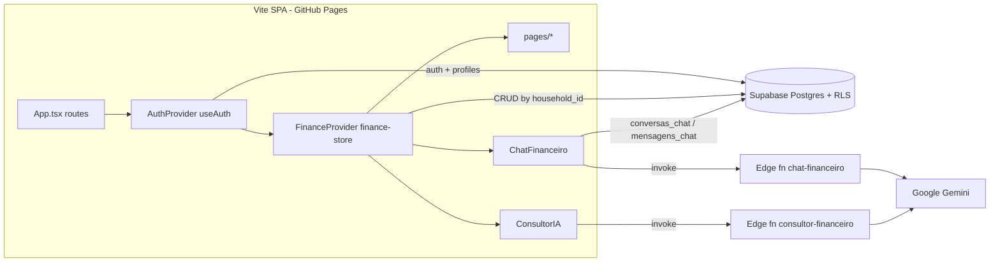

# Architecture

**Pattern:** Client-heavy SPA over BaaS. Browser talks directly to Supabase (PostgREST, RLS enforces tenancy). Server logic only in 2 Supabase Edge Functions (LLM proxies).

## High-Level Structure

## Identified Patterns

### Household multi-tenancy

**Location:** `supabase/migrations/20260326195042_*.sql`, `src/hooks/useAuth.tsx`
**Purpose:** Share data between couple/family members.
**Implementation:** `handle_new_user` trigger creates `households` row + `profiles` row on signup. RLS on every table: `household_id = get_user_household_id(auth.uid())` (SECURITY DEFINER fn). Client reads `profiles.household_id` once in `AuthProvider`, exposes `householdId`.
**Note:** No UI/flow to join another household — each signup gets its own.

### Context store ("finance-store")

**Location:** `src/lib/finance-store.ts`
**Purpose:** Single source of truth for metas, lancamentos, parcelamentos, prioridades + selected month/year + derived totals.
**Implementation:** `useFinanceDataInternal()` hook → `FinanceCtx` via `createElement` (file is `.ts`). On `householdId` change: `Promise.all` loads 4 full tables. CRUD fns: call Supabase → on success patch local state (no refetch, no optimistic rollback). Errors → `toast.error`. Derived totals (`entradas`, `saidas`, `saldo`) computed each render.
**Example:** `addLancamento`, `updateParcelamento` (checks empty `data` to detect RLS block).

### snake_case ↔ camelCase mapping

**Location:** inline in each loader/CRUD fn in `finance-store.ts`
**Implementation:** manual object mapping, `Number()` on NUMERIC columns. Duplicated per entity (load + insert paths).

### Protected routes

**Location:** `src/App.tsx`
**Implementation:** `ProtectedRoute` waits `loading`, redirects `/auth` if no user, wraps children in `FinanceProvider`. `AuthRoute` redirects logged users to `/`. Nested `<Routes>` inside `/*`.

### LLM proxy Edge Functions

**Location:** `supabase/functions/*/index.ts`
**Implementation:** Deno `serve`, CORS `*`, read `GEMINI_API_KEY` env, build system prompt with client-supplied financial context, call `ai.models.generateContent`. `consultor-financeiro` uses `responseSchema` (structured JSON: `resumo_executivo`, `raio_x_alertas`, `alavancagem_metas_prioridades`, `plano_acao[]`). `chat-financeiro` returns `{ reply }`.

## Data Flow

### Auth

1. `Auth.tsx` → `signInWithPassword` / `signUp` (with `full_name` metadata) / `signInWithOAuth(google)` redirect `${origin}/controle-financeiro/`
2. `AuthProvider`: `getSession()` + `onAuthStateChange` → set user → query `profiles.household_id`
3. `ProtectedRoute` renders app once `loading=false`

### Lançamento CRUD

1. `Lancamentos.tsx` form submit → `FormData` → `addLancamento/updateLancamento`
2. Store → `supabase.from("lancamentos").insert/update` with `household_id`
3. Success → local state patch; Dashboard totals recompute from `lancamentosMes`
4. "Copiar do mês anterior" → sequential `await addLancamento` loop

### AI Diagnóstico

`ConsultorIA` (Dashboard) → slim payload (month lancamentos, metas, parcelamentos, prioridades, resumo) → `functions.invoke('consultor-financeiro')` → render 4 sections.

### AI Chat

`AppLayout` Sheet → `ChatFinanceiro` → on first msg create `conversas_chat` row (household from `metas` lookup) → insert user msg in `mensagens_chat` → invoke `chat-financeiro` with full history + context → insert model reply.

## Code Organization

**Approach:** Layer-based, flat: `pages/` (route screens, contain UI + form logic), `components/` (layout + AI widgets), `components/ui/` (shadcn), `hooks/`, `lib/` (store + utils), `integrations/supabase/` (generated client + types).
**Module boundaries:** Pages access data only via `useFinanceData()`; exception: `ChatFinanceiro`, `ConsultorIA`, `useAuth`, `Auth.tsx` call `supabase` directly.
