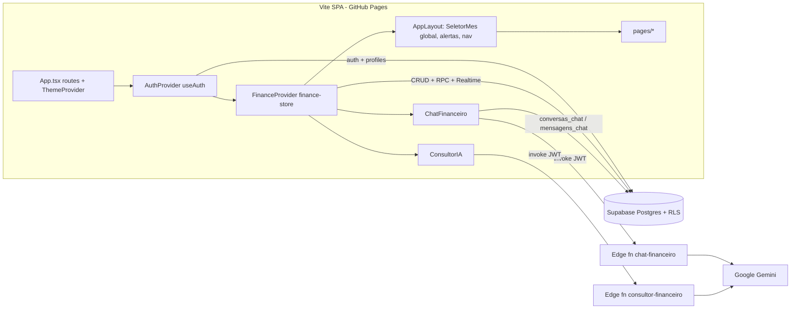

# Architecture

**Pattern:** Client-heavy SPA over BaaS. Browser talks directly to Supabase (PostgREST + RPCs, RLS enforces tenancy). Server logic: SQL functions (batch RPCs) + 2 Supabase Edge Functions (LLM proxies).

## High-Level Structure

## Domain model

- **mes 0–11** everywhere (Janeiro = 0). `new Date(ano, mes, dia)`.
- `lancamentos`: `data` (DATE) + competência `mes/ano`. Entradas/contas fixas/variáveis: mês da data. Cartão: mês da **fatura** (vencimento). `origem` = manual | parcela | recorrente | importado. `status` pago | pendente. `reembolso` (entradas).
- `cartoes`: `dia_fechamento` / `dia_vencimento` (nullable só nos migrados). Fatura: compra < dia de fechamento → fecha no mês; senão no seguinte. Vencimento no mesmo mês do fechamento se `dia_vencimento > dia_fechamento`, senão no seguinte. Dias limitados ao último dia do mês.
- `parcelamentos` vinculados (`cartao_id` + `primeira_fatura_*`) geram 1 lançamento por parcela (`parcelamento_id`, `parcela_num`). Status da parcela é **derivado**: paga se fatura em `faturas_pagas` ou hoje ≥ vencimento. `parcelas_pagas` nos vinculados = parcelas anteriores não geradas. Legados (sem cartão) seguem com `parcelas_pagas` manual.
- `subcategorias` (por household, seed `seed_subcategorias`) + `orcamentos` (override mensal). Limite efetivo = override do mês ?? `limite_padrao`. `conta_no_orcamento=false` (ex.: Compras de Terceiros) fica fora do total.
- `recorrencias`: sempre lançadas numa janela móvel de `MESES_RECORRENCIA` = 6 meses de **data** (mês atual + 5). Unique parcial `(recorrencia_id, mês da data)` evita duplicar. `recorrencias_excecoes` (mês da data) = mês excluído só uma vez, não é regerado. Gerado com data > hoje → `pendente` (cartão: status vem da fatura, campo fica `pago`). "Editado individualmente" = valor ou descrição ≠ recorrência.
- `metas.valor_atual` = saldo inicial; atual = saldo inicial + Σ `aportes`.
- Renda para planejamento = entradas − reembolsos.

## Identified Patterns

### Household multi-tenancy

**Location:** migrations, `src/hooks/useAuth.tsx`
**Implementation:** `handle_new_user` cria household + profile + seed de subcategorias. RLS em todas as tabelas: `household_id = get_user_household_id(auth.uid())`. `households.codigo_convite` + RPC `entrar_household(codigo)` (SECURITY DEFINER) move o perfil para outro household (tela Configurações).

### Store ("finance-store")

**Location:** `src/lib/finance-store.ts` (hook), `src/lib/store/{types,mappers,derivados}.ts`
**Implementation:** `useEntidade()` genérico (load/add/update/remove + toasts) por tabela; um mapper por entidade (`mappers.ts`) usado no load e na escrita. Lotes via RPC (`inserir_lancamentos`, `salvar_parcelamento`, `excluir_parcelamento`, `atualizar_recorrencia_futuros`) e depois recarrega do banco. Realtime: um canal por household assina as tabelas e recarrega a entidade alterada (debounce 400 ms). Totais com `sumMoney` (centavos). Derivados: `limiteEfetivo`, `resumoFatura`, `faturasDoCartao`, `progressoParcelamento`, `statusLancamentoCartao`. Mês/ano selecionado global (`SeletorMes` no topo).

### Domínio puro (testado)

`src/lib/fatura.ts` (fatura, parcelas, status, limite), `money.ts`, `recorrencias.ts`, `parcelamento-ops.ts` (regerar/quitar/aplicar a partir de/duplicados), `importacao.ts` (CSV/OFX), `texto.ts` (normalização/similaridade), `metas.ts`. Sem React/Supabase.

### Formulários reutilizáveis

`LancamentoForm` (sugestão de subcategoria/cartão por histórico, fatura calculada, vira parcelamento se N>1, "só esta / esta e as próximas" em parcelas, vincular aporte em reserva), `ParcelamentoForm` (novo / editar com "aplicar às futuras" / vincular legado com detecção de duplicados), `CartaoFormDialog`, `MoneyInput` (máscara BRL).

### UX transversal

Tema (`next-themes`, classe `.dark`), ocultar valores (`formatCurrency` → `R$ •••••`, localStorage), `AlertasPopover`, skeletons (`PaginaCarregando`), estados vazios (`EstadoVazio`), mobile < md: barra inferior + FAB "+".

### LLM proxy Edge Functions

**Location:** `supabase/functions/*/index.ts`, `_shared/http.ts`
**Implementation:** `Deno.serve`, `verify_jwt = true`, CORS restrito (GH Pages + localhost:8080), limite 200 KB (413), validação mínima do corpo (400), erros JSON com 5xx para falhas do Gemini, `npm:@google/genai@2.19.0` fixado. Contexto montado no cliente por `useContextoIA` (cartões/faturas, parcelas futuras, limites, reembolsos, prioridades, metas+aportes); chat envia só as últimas 20 mensagens.

## Data Flow

### Parcelamento novo

`ParcelamentoForm` → `calcularFatura(dataCompra)` → `gerarParcelas` (centavos, última absorve diferença) → `lancamentosDasParcelas` → RPC `salvar_parcelamento` (upsert parcelamento + apaga ids + insere parcelas numa transação) → store recarrega parcelamentos e lançamentos.

### Recorrências

- **Geração:** efeito no store, depois do carregamento inicial. Chave (`useRef`) = mês atual + recorrências + dias dos cartões; mudou → `lancamentosRecorrentesDaJanela` (pula existentes no mês da data e exceções) → uma chamada de `inserir_lancamentos`. Dispara ao carregar, ao criar/editar/reativar recorrência (inclusive via Realtime) e ao mudar fechamento/vencimento; na virada do mês a janela anda no próximo carregamento. Toast só quando veio de ação do usuário (`avisarGeracaoRef`).
- **Fora da janela** (passado ou além de +5): Lançamentos mostra aviso "Gerar recorrências deste mês" (`lancamentosRecorrentesDoMes`).
- **Editar** (`RecorrenciasDialog`): `propagarEdicao` (futuros não editados individualmente; dia/cartão recalculam data e competência no mesmo mês de data) + `futurosForaDaVigencia` (pausa/fim/início; só pendentes, opcional) → RPC `atualizar_recorrencia_futuros` (recorrência + update + delete numa transação).
- **Excluir recorrência:** opcionalmente apaga futuros pendentes; os demais ficam com `recorrencia_id` NULL (FK). Exceções caem em cascata.
- **Excluir lançamento recorrente:** "Só este mês" = grava exceção + apaga (Desfazer reinsere e remove a exceção; exclusão em massa grava exceção para os recorrentes). "Este e os próximos" = apaga este + pendentes seguintes e define fim no mês anterior (mesma RPC).

### Lançamentos em lote

"Copiar mês anterior", recorrências e importação → `inserirLancamentos` (RPC `inserir_lancamentos`, `ON CONFLICT DO NOTHING`). Edição em massa → `updateLancamentos` (upsert único). Exclusão → `deleteLancamentos` devolve removidos para "Desfazer".

## Code Organization

**Approach:** Layer-based: `pages/` (telas), `components/` (layout, forms, widgets, chips), `components/ui/` (shadcn), `hooks/`, `lib/` (domínio puro + store), `integrations/supabase/` (client + types gerados por `supabase gen types`).
**Module boundaries:** páginas acessam dados via `useFinanceData()`; exceções: `ChatFinanceiro` (tabelas de chat), `ConsultorIA`/Chat (functions.invoke), `useAuth`, `Auth.tsx`.
